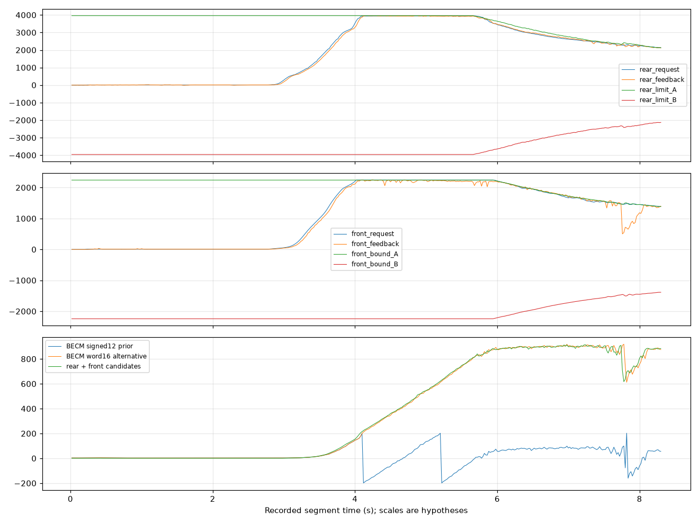

# Full available-raw review — 17 October 2026

**All located vehicle source recordings were processed: 47 unique files, 46 with received traffic, and 17,325,506 RX frames.** There are 39 experiment/historical recording groups, not 47 independent experiments. Of 94 registered paths, duplicate copies and empty attempts do not constitute independent evidence. Six synthetic bench recordings and two infrastructure logs were excluded from vehicle findings.

All 145 backup-manifest entries passed size and SHA256 verification, including 27 capture files totalling 2,486,856,025 bytes. Eleven older TRC recordings and later bridge experiments were also included. One known recording from EXP-0040 is missing. Of the 47 unique vehicle files, 38 had prior hashes in the located manifests and nine did not. Current hashes were recorded and rechecked for all 47; a newly recorded hash cannot establish earlier integrity. Raw recordings remain with the maintainer; public results are not independently reproducible without those recordings. No vehicle frames were transmitted during this review.

## Torque-related candidates

**There are three candidate information families per axle: a request-like field, a tracking response-like field, and one nearly complementary bound amplitude.** Eight encoded fields are listed below. This does not establish six independent physical torque signals, nor separate traction and regeneration limits. Transmitter attribution does not establish receiver or semantic role.

Bit positions use MSB0_LINEAR: bit 0 is the most significant bit of payload byte 0. For an eight-byte payload interpreted as an unsigned big-endian integer, extract `(payload >> (64-start-length)) & ((1<<length)-1)`. These are not DBC Motorola start-bit numbers.

| Axle / proposed role | Transmitter / ID | Start / length | Comparison formula |
|---|---|---|---|
| Rear request | VCU / 0x04B | 12 / 16 | raw × 0.25 − 8190 |
| Rear response | RearDrive / 0x04C | 8 / 14 | raw − 8188 |
| Rear bound A | RearDrive / 0x04C | 40 / 12 | (raw − 2047) × 4 |
| Rear bound B | RearDrive / 0x04C | 52 / 12 | (raw − 2047) × 4 |
| Front request | VCU / 0x050 | 2 / 14 | raw − 8188 |
| Front response | FrontDrive / 0x095 | 18 / 14 | raw − 8188 |
| Front bound A | FrontDrive / 0x13A | 0 / 14 | raw − 8188 |
| Front bound B | FrontDrive / 0x13A | 16 / 14 | raw − 8188 |

All roles remain **CANDIDATE**. Rear field boundaries and the exploratory bound factor of four remain unresolved. No physical shaft-torque calibration in Nm is confirmed. Front numerical values agree with diagnostic quantities labelled Nm, which is a narrower claim than physical calibration or correct diagnostic naming.

The rear pair was selected on one calm-acceleration recording and checked with unchanged formulas on other recordings. Zero-lag level Pearson correlations were 0.99779 on the selection record, 0.99386 with differing axle speeds, 0.99055 in reverse, and 0.99949 at full pedal. Corresponding increment correlations were 0.48749, 0.83446, 0.66988 and 0.75549. A narrow-range coasting record gave only 0.55283 level correlation and −0.08805 increment correlation. This is not universal identity or proof of control direction.

Lag selected on the first recording was frozen at 40 ms for subsequent comparisons. With a 20 ms sampling grid and host receipt timestamps, this is not a measured motor response delay. One- and three-second shift controls, rank correlations and partial correlations controlling candidate vehicle speed were retained in the private analysis. The broad scan evaluated 54,080 field windows; data-driven matches remain exploratory candidates.

## Complementary limits are not absolute invariants

Front 0x13A raw A+B equalled 16376 in **243,070 of 243,076 frames**. Six exceptions remain, including four deviations of one raw count. Rear 0x04C raw A+B equalled 4094 in **486,090 of 486,095 frames**. Five exceptions remain. Unusual payloads were not silently discarded or automatically declared corrupted.

The rear amplitude varies on dynamic recordings, but request values exceeded the exploratory bounds at 35/746 and 12/415 sampled points in two records; response values exceeded them at 5/746 and 5/415. A strict instantaneous clamp is therefore not established. Delayed limits, another physical quantity and redundant amplitude coding remain competing explanations.

## Diagnostics rechecked at actual response completion

Bounded ISO-TP reconstruction used a matching single-DID ReadDataByIdentifier request within one second. Comparisons used the last preceding realtime frame, at most 100 ms old for fast fields. Tablet CSV columns were not treated as simultaneous.

In EXP-0015, E308 matched the front request candidate in 37 comparisons (RMSE 3.87996 diagnostic display units); EEB5 matched the front response in 24 comparisons (RMSE 4.69929). E314/E315 also tracked the front complementary fields. E304 did **not** numerically validate the rear response: 38 comparisons had RMSE 767.44 and maximum discrepancy 2502. Historical MGM/IEM screen labels do not independently establish axle identity.

## Electrical-flow interpretation and correction

RearDrive **0x063, start 2 / length 14**, tentatively scaled as `raw × 0.1 − 818.8`, is more consistent with an electrical-flow interpretation than direct identification as rear torque. Current versus power and physical units remain unresolved.

The previously proposed BECM 0x143 **signed 12-bit** current decoder does not generalize to high load: it exhibits discontinuities. A new exploratory alternative uses the full first unsigned big-endian 16-bit word with `raw × 0.1 − 4914.8`. This avoids those discontinuities and correlates with the sum of rear and front current candidates (r=0.99837 on a high-load recording), but it was selected after examining those dynamics. That is not an independent validation set. Status bits, range and physical scaling require new evidence. The old candidate remains in the matrix with an explicit restriction, not an unqualified current specification.

AC-voltage candidate 0x178 also failed a useful dynamic check: 135 diagnostic comparisons showed variation in the diagnostic value while the realtime field stayed constant. A matching numeric range is insufficient.

A high-load recording, recorded segment time 0–8.3 seconds. Upper panel: rear fields; middle: front fields; lower: competing battery-current representations and drive-current sum. All displayed scales are hypotheses. The full-word alternative was selected using these dynamics, so this figure is not independent validation.

## State model and remaining work

Brake-related VCU bits matched 304/310 bounded CSV comparisons in EXP-0033, but event timestamps and polling uncertainty prevent definitive pedal semantics. Requested and accepted selector states, drive enable/fault, rear motor speed and contactor states remain unresolved. Message onset alone does not establish sleep, READY or HV readiness. Sources of 0x036/0x041 remain unassigned.

The defensible model currently links transmitter groups and correlated candidate fields. It does not establish a complete drive-control protocol. Minimum additional evidence is:

1. Independently identified rear request, response and units, specifically resolving E304 versus 0x04C.
2. A labelled condition where traction and regeneration limits differ.
3. Simultaneous diagnostic current references spanning the suspected signed12 discontinuities.
4. Explicit action timestamps for selector/brake, plus an independent HV/contactor status reference.

The public matrix now contains **41 signal rows: 35 candidates, two unknown fields and four confirmed VIN-layout fields**. No new physical signal was promoted to CONFIRMED. See the [role matrix](../database/drive_role_hypotheses.csv) and [English workbook](Zeekr_X_CAN_Matrix_EN.xlsx).
